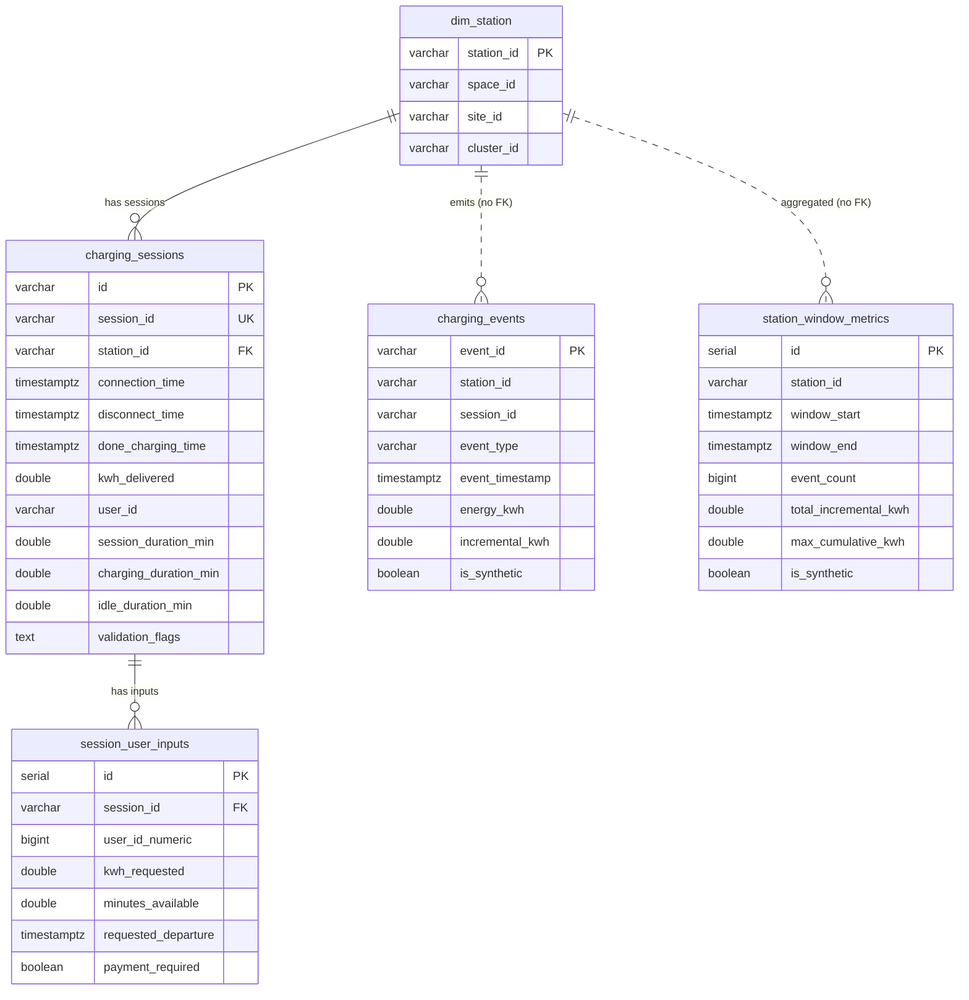

# ER Diagram (PostgreSQL warehouse)

Real historical data: dim_station, charging_sessions, session_user_inputs.
Simulated streaming data: charging_events, station_window_metrics.

Solid lines are enforced foreign keys. Dotted lines are logical links only: simulated
tables deliberately have no foreign key, so a wrong simulated station cannot crash the
stream. Quality check Q11 detects such rows.